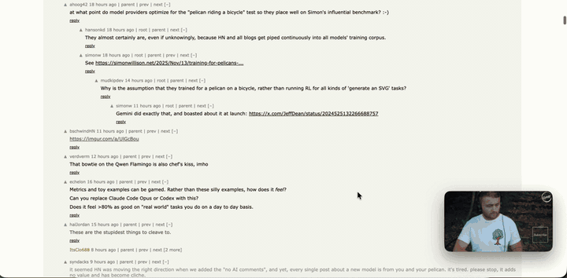

<h1>Hover</h1>

A floating YouTube window for your Mac. 
Always on top, signed in across restarts, fullscreen inside its own window.

<strong>Version 1.2.0</strong> · macOS 13+ · Apple Silicon & Intel

  
  
  
  

<a href="https://github.com/madebysan/hover/releases/latest">Download Hover</a>

Hover keeps a small YouTube window in a corner of your Mac, so a playlist can play while you work.

- It floats above every app, fullscreen ones included, and reopens where you left it.
- Fullscreen fills the window, not your screen, so your other apps stay put.
- It opens to your Watch Later list, or any start page you pick.

## How it works

Hover is a WebKit browser window that stays on top and keeps its cookies, so there's no YouTube API or OAuth involved. You don't need to sign in; signed out, it opens YouTube Home. Press `f` or double-click the video for fullscreen; Hover intercepts YouTube's own fullscreen and hides the page around the player instead. Drag anywhere on the video to move the window, resize from any edge and it keeps the video's shape, and use `Cmd +` and `Cmd -` to set opacity between 20% and 100%. Every shortcut and how each part works are in [docs/how-it-works.md](docs/how-it-works.md).

## Limits

Fullscreen depends on how YouTube's page is built, so a YouTube redesign can break it until Hover is updated. YouTube Premium is recommended; without it, ads play as usual.

Hover only does YouTube. For other sites, every Mac browser has picture-in-picture, and [Floating](https://apps.apple.com/us/app/floating-picture-in-picture/id1508833245) pins any website above other windows.

## Install

Download Hover.dmg from the [latest release](https://github.com/madebysan/hover/releases/latest) and drag Hover to Applications. It's signed and notarized, needs macOS 13 or later, and updates itself through [Sparkle](https://sparkle-project.org).

To build it, run `swift build -c release` for the binary, or `./scripts/build-dmg.sh` for a signed `dist/Hover.app` and `dist/Hover.dmg` with Sparkle embedded.

---

[MIT](LICENSE). Hover uses [Sparkle](https://github.com/sparkle-project/Sparkle); its license is in [THIRD_PARTY_NOTICES.md](THIRD_PARTY_NOTICES.md).

Made by [santiagoalonso.com](https://santiagoalonso.com)
